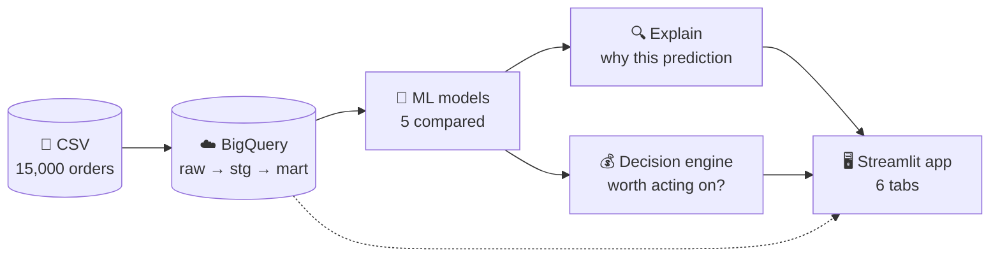
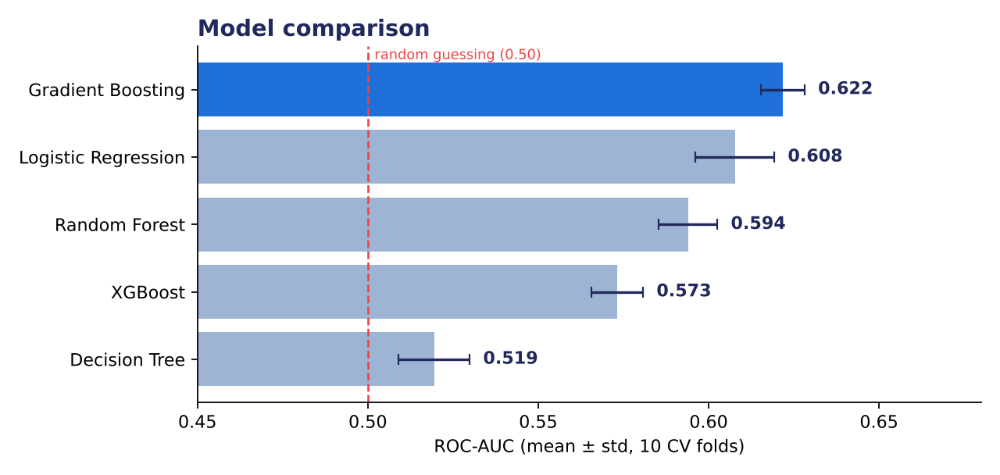
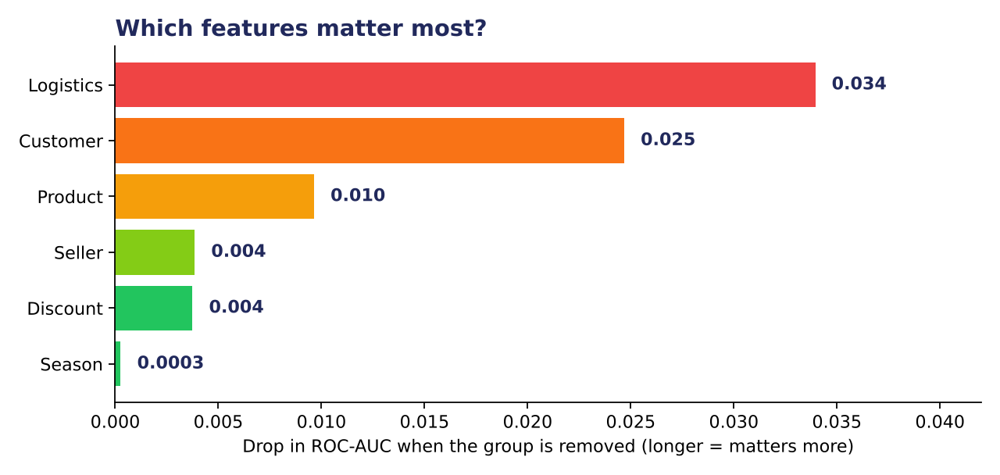
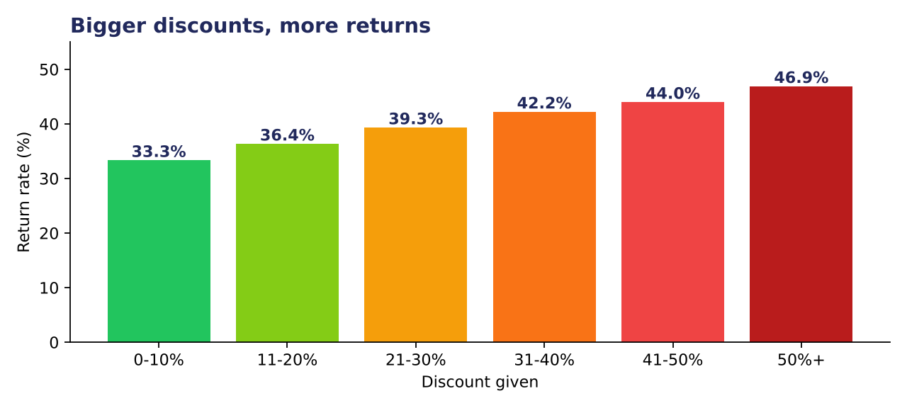

<div align="center">

# 🛒 Return Risk AI

### Explainable E-Commerce Return Prediction & Decision Pipeline

*Predicts which orders will be returned, explains **why**, and decides which ones are **worth acting on**.*


**[🚀 Live App](https://return-risk-ai.streamlit.app/)** &nbsp;·&nbsp; **[📊 Results](#-results)** &nbsp;·&nbsp; **[⚙️ Run it yourself](#%EF%B8%8F-run-it-yourself)** &nbsp;·&nbsp; **[🧱 Project structure](#-project-structure)**

</div>

---

## 📌 Contents

[Why this project](#-why-this-project) · [Highlights](#-highlights) · [How it works](#-how-it-works) · [App tour](#%EF%B8%8F-app-tour) · [Results](#-results) · [Decision engine](#-decision-engine) · [Explainability](#-explainability) · [BigQuery pipeline](#%EF%B8%8F-bigquery-pipeline) · [Run it yourself](#%EF%B8%8F-run-it-yourself) · [Structure](#-project-structure) · [Tech stack](#%EF%B8%8F-tech-stack)

---

## 💡 Why this project

Most return-prediction projects stop at *"this order has a 63% chance of being returned."*
A business can't act on a probability alone. This project goes three steps further:

| Step | Question it answers | How |
|---|---|---|
| 1. **Predict** | Will this order be returned? | 5 models compared, best one selected |
| 2. **Explain** | Why does the model think so? | Plain-English reasons per order |
| 3. **Decide** | Is it worth doing something about it? | Cost-based decision engine (expected loss vs cost of acting) |

---

## ✨ Highlights

| | |
|---|---|
| 📦 **Data** | 15,000 orders · 18 cities · 38.2% return rate |
| 🏆 **Best model** | Gradient Boosting · ROC-AUC **0.622 ± 0.006** (10-fold CV) |
| 📈 **Statistical rigor** | Significantly better than all 4 other models (corrected resampled t-test, p < 0.05) |
| 💰 **Decision engine** | **30.9%** of orders (4,638 / 15,000) are worth intervening on, an estimated **₹80 lakh** potential savings* |
| 🔍 **Explainable** | Every prediction comes with its top 3 reasons |
| ☁️ **Cloud pipeline** | Google BigQuery warehouse: raw → staging → mart |
| 🖥️ **App** | 6-tab Streamlit app with a live what-if simulator |

<sub>*Estimate under stated cost assumptions (see [Decision engine](#-decision-engine)); not a guaranteed saving.</sub>

---

## 🧭 How it works



---

## 🖥️ App tour


<summary><b>🔮 1. Predict</b> — score one order, get a reason and a decision</summary>

<br>

Fill in an order (price, discount, delivery days, payment method…) and get:
- a **risk gauge** with Low / Medium / High tier
- risk signals (high discount, late delivery, Cash on Delivery…)
- a **business decision**: expected loss vs cost of acting
- **"Why this prediction?"**: the top 3 factors, in plain English

<summary><b>📁 2. Batch Prediction</b> — upload a CSV of orders</summary>

<br>

Upload orders, get every row scored with risk tier and decision, plus summary totals (orders scored, worth intervening on, total potential savings). Download the scored file.

<summary><b>📊 3. EDA Dashboard</b> — explore the return patterns</summary>

<br>

Return-reason donut, KPI row, an interactive "explore return rate by…" selector, a category treemap, a payment-flow sunburst and a correlation heatmap.

<summary><b>🎚️ 4. What-If Explorer</b> — drag sliders, watch the risk move</summary>

<br>

Sliders for discount, delivery days, price and seller rating. The risk gauge and the recommendation update instantly.

<summary><b>🗺️ 5. Returns Map</b> — return rate by city</summary>

<br>

An interactive map of 18 Indian cities, sized by order volume and coloured by return rate.

<summary><b>☁️ 6. BigQuery Pipeline</b> — how the data flows through the warehouse</summary>

<br>

Shows each warehouse layer and what happens in it, from the raw CSV to the model's predictions.

---

## 📊 Results

### Model comparison

Five models, evaluated with 5-fold cross-validation repeated twice (10 folds).



<summary><b>See the full table and significance tests</b></summary>

<br>

| Model | ROC-AUC (mean ± std) |
|---|---|
| **Gradient Boosting** | **0.622 ± 0.006** |
| Logistic Regression | 0.608 ± 0.012 |
| Random Forest | 0.594 ± 0.009 |
| XGBoost | 0.573 ± 0.008 |
| Decision Tree | 0.519 ± 0.010 |
| Majority-class baseline | 0.500 |

Gradient Boosting vs every other model: **p < 0.05** (Nadeau–Bengio corrected resampled t-test; Wilcoxon signed-rank agrees). Closest rival: Logistic Regression (p = 0.019).

Hyperparameter tuning (randomized search) improved the held-out score only slightly, 0.617 → 0.620, so the limit comes from the information in the data, not from the model settings.

### What drives returns? (ablation study)

Remove one group of features at a time and see how much the model suffers.



**Takeaway:** logistics (delivery, shipping, payment) and customer features carry the most signal. The festival-season flag adds almost nothing.

### Discounts and returns



Orders with 0–10% discount earn the most expected profit per order (₹9,320); orders with 50%+ discount are returned 46.9% of the time versus 33.3%.

---

## 💰 Decision engine

A probability is only useful if it changes what you do. For each order:

```
expected_loss = P(return) × (₹150 restocking/shipping  +  15% × price)
act only if   expected_loss − ₹800 intervention cost  >  0
```

- **30.9%** of orders (4,638 of 15,000) clear that bar.
- Estimated total net benefit: **₹80.0 lakh**.
- The ₹800 cost was **calibrated**: at a lower cost, 98.6% of orders were flagged, which is useless in practice.

> All three cost numbers are adjustable assumptions in [`decision_engine.py`](decision_engine.py). Change them to match a real business.

---

## 🔍 Explainability

Each prediction comes with its top reasons. The method is **feature perturbation**: swap each feature for the dataset median and measure how far the predicted probability moves.

<summary><b>Example output</b></summary>

<br>

| Factor | Effect on return probability |
|---|---|
| Late delivery | 🔴 +0.076 (pushes risk up) |
| Warranty availability | 🟢 −0.081 (pulls risk down) |
| Payment method | 🟢 −0.092 (pulls risk down) |

<summary><b>Why not SHAP?</b></summary>

<br>

SHAP depends on `numba`, whose DLLs were blocked by Windows Application Control on the development machine. A simpler perturbation explainer ([`explain.py`](explain.py)) replaced it.

---

## ☁️ BigQuery pipeline

| Layer | Table(s) | What happens |
|---|---|---|
| **raw** | `raw.orders` | CSV loaded as-is with `load_to_bigquery.py` |
| **stg** | `stg.orders` | Trim text, remove duplicates, build engineered flags |
| **mart** | `fact_orders`, `dim_product`, `dim_date` | Star schema ready for analysis |
| **mart** | `fact_predictions` | Return probability and risk tier per order (`predict.py`) |

<summary><b>Run the pipeline</b></summary>

<br>

```bash
python load_to_bigquery.py     # CSV → raw.orders
# run transform.sql in the BigQuery console (staging + mart)
python predict.py              # scores orders → mart.fact_predictions
```

Needs a Google Cloud project and a service-account key. Never commit the key to Git (`.gitignore` already blocks `*.json`).

---

## ⚙️ Run it yourself

```bash
git clone https://github.com/Shinearushi525/return-risk-ai.git
cd return-risk-ai
pip install -r requirements.txt
streamlit run app.py
```

The trained model is included, so the app starts immediately. To retrain and re-run the full evaluation:

```bash
python train_model.py            # train 5 models, save the best
python research_evaluation.py    # CV, significance tests, ablation, tuning
```
<summary><b>Deploy on Streamlit Cloud</b></summary>

<br>

See [`DEPLOY_SETUP.md`](DEPLOY_SETUP.md).

---

## 🧱 Project structure

```
├── app.py                    Streamlit app (6 tabs)
├── train_model.py            trains and compares 5 models, saves the best
├── research_evaluation.py    cross-validation, significance tests, ablation, tuning
├── decision_engine.py        cost-based "worth acting on?" logic
├── explain.py                perturbation-based explanations
├── load_to_bigquery.py       CSV → BigQuery raw layer
├── transform.sql             raw → staging → mart (star schema)
├── predict.py                scores orders → mart.fact_predictions
├── schema.sql                raw table definition
├── research_results/         evaluation tables (CSV + RESULTS.md)
├── assets/                   charts used in this README
└── ecommerce_product_returns.csv
```

---

## Honest notes

- **Modest predictive power.** ROC-AUC ≈ 0.62: returns are only weakly predictable from these features. The project's value is in the explanations, the decisions and the pipeline, not a headline accuracy.
- **Savings are estimates.** The ₹80 lakh figure depends on assumed costs (₹800 / ₹150 / 15%), not measured outcomes.
- **Fairness gap.** Recall differs by customer type: **Loyal 13.9%**, Returning 22.3%, **New 34.0%**. The model catches returns from new customers far better than from loyal ones. By city (spread 0.11) and age band (spread 0.06) it is more even.
- **Single dataset.** Results come from one 15,000-order dataset; external validation is future work.
- **Explanations are model-based, not causal.** They show what the model relies on, not proof that changing a feature changes a customer's behaviour.

---

## 🛠️ Tech stack

Python · pandas · NumPy · scikit-learn · XGBoost · SciPy · Plotly · Streamlit · Google BigQuery · SQL

---


## 👨‍💻 Author

<div align="center">

**Arushi Garg**


[](https://www.linkedin.com/in/arushi-garg525/)
[](https://github.com/Shinearushi525)
[](mailto:Arushigarg525@gmail.com)


If this project helped you, consider giving it a ⭐

</div>
